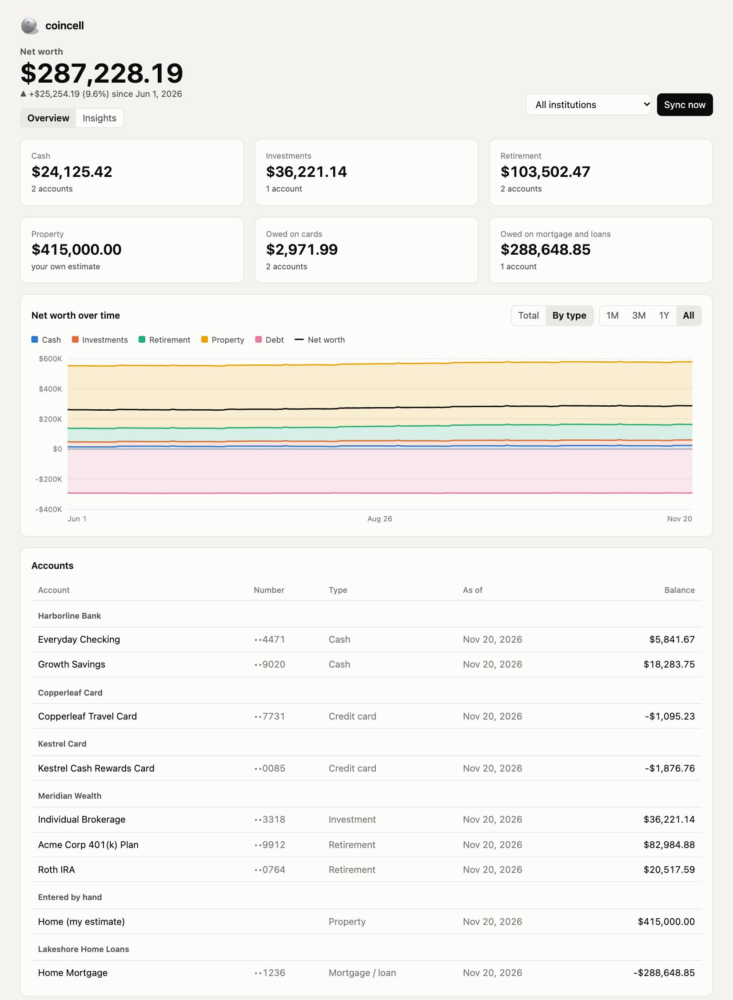

# coincell

A local dashboard for your own money. It logs in to each of your banks, cards, brokers and lenders with a
real browser, reads balances, holdings and transactions, and shows them together: net worth over time, cash
flow, upcoming payments, and an Insights tab with suggestions and charts. Everything stays on your machine.

It currently ships wired to five made-up institutions (`fakebanks/`) so the whole thing can be run and tested
end to end without real accounts. Scrapers for real institutions are written one at a time from the template.



<details><summary>Insights tab</summary>


</details>

## Run it

```sh
npm install
npx playwright install chromium   # only if Google Chrome is not installed
npm run fakebanks &               # the five demo institutions, ports 4701-4705
npm start                         # http://localhost:4680, then press "Sync now"
```

- `npm run fakebanks`: start the made-up institutions the app is currently wired to (ports 4701-4705):
  Harborline Bank (checking + savings), Kestrel Card, Copperleaf Card, Meridian Wealth (brokerage, Roth IRA, 401(k))
  and Lakeshore Home Loans (mortgage). Their logins are filled in automatically.
- `npm run sync -- all`: sync every institution from the command line (same as the "Sync now" button), or name one.
- `node scripts/verify-fake.js`: after a sync, compare what was scraped with what the fake institutions really hold.
- `npm run record -- <login url>`: log in by hand and click around; writes the shape of every JSON call the bank's site makes (values redacted) to `.data/recordings/`. Use it to write an adapter.

## Insights tab

A suggestions panel and charts (saved vs market, a money flow diagram, a spending calendar, the cash runway,
mortgage payoff curves, and a projection of when investments could cover spending), plus tables for:
savings rate, net worth change split into saved vs market, spending by category and payee, recurring bills,
cash runway, asset allocation, transactions worth a second look, and debt payoff. The rules behind them are in
`insights-config.json`: spending categories (first matching pattern wins), asset class per symbol, allocation
targets, the low-balance warning level, and the extra mortgage payment scenarios. Edit and reload; nothing is stored.
`manual-assets.json` holds values no website reports, such as your home.

## Adding a bank

Copy `src/banks/mybank.js`, fill in the TODOs, and register it in `src/banks/index.js`. An adapter returns
`{ accounts: [{ id, name, type, balance, holdings?, transactions?, history?, dueAmount?, dueDate? }] }`;
debts are negative balances and money going out is a negative amount. The four demo adapters in `src/banks/`
show four techniques: page scraping, listening to the site's JSON, CSV export, and calling the site's API.

Browser automation may be against an institution's terms of use, and some block automated browsers. Check before relying on it.

## Where things live

- `.data/coincell.sqlite`: all synced data. `.data/profiles/`: the browser profile per bank (session cookies).
  Both stay on this machine and are git-ignored. Treat `.data/` like a password file.
- You type your password and 2FA codes into the bank's own page in a visible browser window. The app never reads or stores them.
- The server listens on 127.0.0.1 only.

## Icon

The icon is a 3D coin cell modelled in three.js. Edit `icon/scene.js`, then `cd icon && npm ci && node build.js`.
